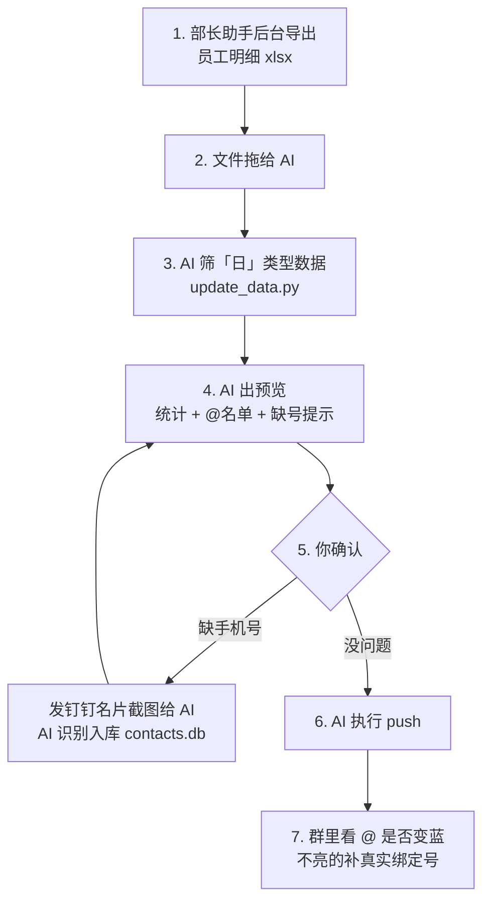

# 管理驾驶舱「已读情况提醒」钉钉机器人

每天定时把「昨日员工消息已读情况」推到钉钉群：**一条统计卡片 + 一条逐人 @ 提醒**，被 @ 的人手机会收到通知。

纯 Python + 本地 Excel，没有服务端、没有数据库服务、不需要公网 IP。
**没有开发权限也能跑**——用群自定义机器人（webhook 模式）即可，无需管理员给你开凭证。

---

## 目录

- [它长什么样](#它长什么样)
- [为什么值得用](#为什么值得用)
- [最快上手：让 AI 带你装（强烈推荐）](#最快上手让-ai-带你装强烈推荐)
- [手动安装（分步说明）](#手动安装分步说明)
- [每日使用流程（含与 AI 协作）](#每日使用流程含与-ai-协作)
- [统计口径](#统计口径)
- [两种运行模式](#两种运行模式)
- [项目结构](#项目结构)
- [接入其他省区 / 其他系统导出的表](#接入其他省区--其他系统导出的表)
- [多团队共用](#多团队共用)
- [关于 @ 不到人](#关于-不到人)
- [常见问题](#常见问题)
- [安全说明](#安全说明)
- [License](#license)

---

## 它长什么样

每天推送两条消息到群里：

**第 1 条 · 主统计卡片**（actionCard 卡片样式，全员可见，不 @ 人）

```
📊【11月4日 昨日助手消息已读情况提醒】

📈 昨日使用率（≥50%）汇总：整体使用率 85.06%

⛔ 未使用（<50%）14人（详见下一条 @提醒）

🎉 已全部读完（63人）

📋 部分已读（12人）

🚀 请大家及时查看管理驾驶舱消息，不要一键已读
```

**第 2 条 · 未使用人员 @ 提醒**（逐人一行，蓝色可点击 @，被 @ 的人收到通知）

```
【11月4日 昨日助手消息已读情况提醒】

⛔ 未使用人员提醒（14人）：

• @吴冬杰（中心质量监督控制主管）已读 0/38，使用率 0.00%
• @王万祥（操作主管）已读 0/1，使用率 0.00%
• @杨洪（操作主管）已读 0/2，使用率 0.00%
...
```

---

## 为什么值得用

- **不用人肉统计**：以前要开后台、拉表、算使用率、一个个找谁没看——现在一条命令，或干脆定时全自动。
- **提醒真能到人**：普通通报发出去没人看，逐人 @ 会弹手机通知，这是唯一有效的施压方式。
- **零权限能落地**：企业微信/钉钉的互动卡片都要开发者权限，这套用群自定义机器人绕过了这道门，5 分钟就能跑起来。
- **手机号只填一次**：姓名 → 手机号存在本地 SQLite，以后换表、换日期都不用重填。
- **日期不会标错**：数据文件内嵌所属日期，凌晨补发也不会把「11月2日」写成「11月3日」。
- **数据不出本机**：员工姓名、手机号、已读明细全在你自己电脑的 `data/` 里，不上传任何服务器。

---

## 最快上手：让 AI 带你装（强烈推荐）

这套工具的命令不多，但中间夹着钉钉后台的点击操作（建应用、加机器人、拿 webhook、开加签），新手照着文字做容易卡在某一步不知道错在哪。
**最省事的方式是让 AI 一边问你情况、一边替你执行命令。**

### 第 1 步：装一个能读写本机文件的 AI 助手（WorkBuddy）

推荐 **WorkBuddy**——它能在你电脑上直接执行命令、读写文件，正好适合这种「AI 指导 + AI 代跑」的场景，不用你抄命令。

- 注册入口（含邀请码 `llla3tvqod`）：**https://www.workbuddy.cn/events/invite?inviteCode=llla3tvqod**
- **每天签到可领积分，日常用它跑这套流程基本不花钱**，够支撑「发文件 → 筛选 → 预览 → 推送」这种每天一次的操作量。

> 说明：以上是项目作者的邀请链接，走这个链接注册对作者有积分奖励，不影响你的使用成本。
> 用其他支持本地文件读写的 AI 工具也可以，原理一样。

### 第 2 步：把仓库拉下来

```bash
git clone https://github.com/Cosm1cAC/dingtalk-read-reminder
```

不会用 git 也行：在 GitHub 页面点 **Code → Download ZIP**，解压到一个**路径里没有中文和空格**的目录，例如 `D:\dingtalk-read-reminder`。

### 第 3 步：把下面这段直接粘贴给 AI

把仓库目录告诉 AI，让它读 `README.md` 带你一步步做（**照抄，只改路径**）：

```text
我已把 https://github.com/Cosm1cAC/dingtalk-read-reminder 下载到 D:\dingtalk-read-reminder，
请你先完整读一遍目录里的 README.md，然后按「手动安装（分步说明）」一步步指导我完成配置。

要求：
1. 先问我有没有钉钉开发者权限，再决定用 webhook 模式（零权限）还是 app 模式（互动卡片）；
2. 需要我在钉钉后台操作的地方，请分步告诉我点哪里，等我做完回复你；
3. 我需要提供 webhook 地址、加签密钥、群 ID 时，你直接告诉我从哪个页面复制；
4. 每一步命令请你直接执行，并把报错原文读给我听、帮我定位；
5. 每完成一步停下来等我确认，不要一次抛给我一堆命令；
6. 最后用一条测试数据跑通 push，确认群里能收到两条消息。
```

AI 会依次带你走完：判断模式 → 装依赖 → 填配置 → 生成模板 → 试推一条 → 配定时。
**卡住时直接把报错原文粘给 AI**，比你自己搜快得多。

### 第 4 步（可选）：日常也交给 AI

配置好之后，每天的工作可以压缩成一句话：把导出的 Excel 拖进对话，说「更新今天的数据并出预览」。
详见 [每日使用流程](#每日使用流程含与-ai-协作)。

---

## 手动安装（分步说明）

不想用 AI，或者想让 AI 只做最后一步校验，就按下面手动来。
**全程 15 分钟左右**，难点在第 2 步（钉钉后台拿 webhook）。

### 第 0 步：装依赖

```bash
pip install -r requirements.txt
```

国内网络/代理异常时用镜像：

```bash
python -m pip install -i https://mirrors.aliyun.com/pypi/simple/ -r requirements.txt
```

> 代码里所有请求都走 `requests.Session(trust_env=False)`，**刻意无视系统代理**——避免机器上残留的失效代理（比如公司 VPN 留下的 `127.0.0.1:7890`）导致所有请求超时。

### 第 1 步：拿 webhook（群自定义机器人，零权限）

在**目标钉钉群**里操作，不需要管理员：

1. 群右上角 **设置**（齿轮）→ **机器人** → **添加机器人** → 选 **自定义**（有的版本叫「Webhook 接入」/「自定义机器人」）
2. 起个名字，比如 `中心管理助手`
3. **安全设置勾「加签」**（不要选「自定义关键词」，否则消息里没有关键词就会被拒）
4. 创建完成后页面会给出两条信息，**都复制下来**：
   - Webhook 地址：`https://oapi.dingtalk.com/robot/send?access_token=xxxxx`
   - 加签密钥：`SECxxxxx`

> 如果找不到「自定义」选项，说明群主/管理员关闭了机器人权限，需要请群主打开，或者让他按这个步骤帮你建一个把地址给你。

### 第 2 步：填配置

```bash
cp config.example.yaml config.yaml        # Windows CMD: copy config.example.yaml config.yaml
```

编辑 `config.yaml`，最少只改这三行：

```yaml
webhook:
  webhook_url: "https://oapi.dingtalk.com/robot/send?access_token=你复制的"
  secret: "SEC你复制的"

data:
  data_file: "data/当前统计.xlsx"          # 数据表路径，一般不用改
```

其余项含义（都有默认值，可以先不动）：

| 配置项 | 作用 |
|---|---|
| `card.show_detail_names` | `false` = 主卡片只报人数（推荐，人名只在第 2 条出现）；`true` = 未使用/部分已读逐人列在主卡片里 |
| `schedule.push_time` | `daemon` 模式的每日推送时间，默认 `17:00` |
| `dingtalk.*` | app 模式凭证，webhook 模式留空即可 |
| `dingtalk.card_template_id` | 卡片平台模板 ID，不填则用 markdown 兜底（无按钮） |

### 第 3 步：准备数据

两种方式，选一种：

**A. 手工填表（适合先跑通）**

```bash
python main.py make-template
```

生成 `data/当前统计.xlsx`，五列固定表头，从第 2 行起每人一行：

| 姓名 | 手机号 | 职位 | 应读条数 | 已读条数 |
|---|---|---|---|---|
| 张三 | 13800000001 | 安全管理员 | 7 | 2 |
| 李四 | 13800000002 | 部门负责人 | 30 | 15 |

- **手机号可以是空的**——留空则该人只能被点名、收不到 @ 通知；填了就能真 @ 到
- 手机号必须是对方**钉钉账号绑定的号码**，不是人事系统登记的那个（见 [关于 @ 不到人](#关于-不到人)）
- 模板自带 4 行示例数据（张三/李四/王五/赵六），正式用之前删掉或改掉

**B. 从系统导出表自动生成（适合日常）**

见 [每日使用流程](#每日使用流程含与-ai-协作)，一条命令完成筛选、汇总、校验。

### 第 4 步：试推一次

```bash
python main.py push
```

成功时输出：

```
[OK] 主统计消息已按 actionCard 卡片样式发送
[OK] 未使用人员 @提醒已发送（@13800000001, @13800000002）
```

去群里确认两条消息都到了、@ 是蓝色的。**到这一步就算装完了**，接下来配定时。

### 第 5 步：配定时（每天自动发）

**Windows 计划任务**（推荐）：

```bat
schtasks /Create /TN "钉钉已读提醒" /TR "cmd /c cd /d D:\dingtalk-read-reminder && python main.py push" /SC DAILY /ST 17:00
```

验证与删除：

```bat
schtasks /Query /TN "钉钉已读提醒"          :: 查看是否创建成功
schtasks /Run   /TN "钉钉已读提醒"          :: 立刻手动触发一次
schtasks /Delete /TN "钉钉已读提醒" /F      :: 删除
```

**或者常驻进程自己管时间**（适合服务器/不想用计划任务）：

```bash
python main.py daemon        # 读 config.yaml 的 schedule.push_time，Ctrl+C 退出
```

**macOS / Linux** 用 crontab：

```bash
0 17 * * * cd /path/to/dingtalk-read-reminder && /usr/bin/python3 main.py push
```

> ⚠️ **定时任务只负责「发」，不负责「取数」**。它读的是 `data/当前统计.xlsx` 里当时的内容。
> 也就是说，**数据和手机号必须在推送前准备好**，否则发出去的是旧数据（或者第一次的空表）。
> 每天的数据更新方式见下一节；如果连取数也想全自动，把导出文件固定丢到某个目录，再串一个 `update_data.py` 到计划任务里即可。

---

## 每日使用流程（含与 AI 协作）

下面是这套工具在真实使用中沉淀下来的完整流程。
如果装好了 WorkBuddy，**你真正要做的只有第 1 步和第 5 步**，中间全由 AI 完成。



### 第 1 步：导出昨天的明细

进「部长助手」后台 → 员工明细 → 导出 Excel，文件名形如：

```
部长助手➣部长助手-员工明细_20261105152959.xlsx
```

> 导出表里**每人两行**：类型 `日` = 当天数据，类型 `月` = 当月累计。
> 必须只取 `日`，取错会得到完全不同的数字（月初两者恰好相同，容易误判）。

### 第 2 步：把文件交给 AI

在 WorkBuddy 对话里把文件拖进去（或输入 `@文件路径`），配一句话：

```text
这是今天导出的员工明细，取 11月4日 的数据更新统计表，然后给我看两条消息的预览，先不要推送。
```

### 第 3 步：AI 更新数据并交叉验证

AI 实际执行的命令：

```bash
python update_data.py <员工明细.xlsx> 2026-11-04
```

它做四件事：

1. 打印表里的**日期/类型分布**（确认有哪些日期、日/月各多少行）
2. 只筛 `类型=日` 且 `日期=指定日期` 的行，按姓名汇总
3. 写入 `data/当前统计.xlsx`，并在隐藏的 `meta` 表里记下**数据所属日期**
4. **逐人交叉验证**：把写入结果和源表再比一遍，输出「差异 0」

不传日期时自动取表内最新的「日」类型日期。

### 第 4 步：AI 生成预览，你审

AI 会用真实数据渲染出两条消息的完整文本，并额外提示：

- 整体使用率、三类人数
- **未使用名单里谁没有手机号**（这些人 @ 不到、收不到通知）
- 有没有明显的异常（比如某人应读只有 1 条、某人 0/85）

这一步**不让 AI 直接推**，就是为了让你先看数字和名单对不对。数据错了发出去，群里几百人看着。

### 第 5 步：补手机号（按需）

缺号的人发**钉钉个人名片截图**给 AI，说「加这几个人的手机号」，AI 会：

1. 识别姓名 + 手机号
2. 写入 `data/contacts.db`（SQLite，`contacts` 表：name / mobile / updated_at）
3. 之后每次读 Excel 时，**手机号为空的行自动按姓名从库里补齐**——所以只填一次，永久复用

也可以自己批量导入：

```python
import contacts
contacts.import_pairs([("张三", "13800000001"), ("李四", "13800000002")])
```

或直接往 Excel 的「手机号」列里填（Excel 优先级高于库）。

### 第 6 步：推送

你说一句「推」，AI 执行：

```bash
python main.py push
```

发送两条消息（顺序固定）：

1. **actionCard 主统计卡片** — 走 `send_actioncard_via_webhook()`，加签
2. **markdown 未使用 @ 提醒** — 走 `send_via_webhook()`，带 `atMobiles`

> 为什么第 1 条用 card、第 2 条用 markdown：**actionCard 不支持 @ 人**，所以必须拆成两条。

### 第 7 步：验收 @ 效果

去群里看第 2 条消息里的人名：

- **蓝色可点击** = @ 成功，对方收到通知 ✅
- **黑色普通文字** = 号码不是他钉钉绑定的号，对方**收不到任何通知** ❌

发现黑的，按 [关于 @ 不到人](#关于-不到人) 处理。拿到正确号码后不必重发整条，让 AI 单独补一条只 @ 他的消息即可。

### 每天的实际耗时

从「导出文件」到「群里收到消息」，熟练后 **约 10 分钟**，其中你的操作只有两次：拖文件、说「推」。

---

## 统计口径

| 指标 | 定义 |
|---|---|
| 单人使用率 | 已读条数 ÷ 应读条数 |
| **未使用** | 使用率 **< 50%**，进入第 2 条 @ 提醒名单 |
| **已全部读完** | 已读 == 应读（**注意：应读为 0 的人不算**，避免除零误判） |
| **部分已读** | ≥ 50% 但未读完，按完成率降序排列 |
| 整体使用率 | Σ已读 ÷ Σ应读（不是各人使用率的平均） |

阈值 50% 写在 `excel_stats.py` 的 `THRESHOLD = 0.5` 常量，想改直接改这一个数（卡片文案里的 `≥50%` 会跟着变）。

---

## 两种运行模式

| | **webhook 模式（零权限）** | **app 模式（完整版）** |
|---|---|---|
| 前置条件 | 群内加「自定义」机器人即可，**无需开发权限** | 需企业管理员分配开发者权限 / 给 AppKey |
| 消息样式 | actionCard 卡片样式（**无红绿配色、无按钮**） | 卡片平台互动卡片（可还原配色 + 「收到/回复」按钮） |
| @ 人 | ✅ 按手机号 | ✅ 按手机号或 userid |
| 定时推送 | ✅ | ✅ |
| 按钮交互 | ❌ | ✅ Stream 模式回调，**不需要公网 IP** |
| 配置项 | `webhook.webhook_url` + `secret` | `dingtalk.*` + `card_template_id` |

**webhook 有值时会优先走 webhook**。想升级到 app 模式：填好 `dingtalk` 段、把 `webhook.webhook_url` 置空即可，Excel 和统计逻辑一行都不用改。

> 顺带提醒：**「快捷应用」解决不了这个问题**。它只是把一个现成网页挂到工作台入口，要填 `https://` 网址，不下发 AppKey/AppSecret，和机器人消息能力完全是两条线。

---

## 项目结构

| 文件 | 作用 |
|---|---|
| `main.py` | 主入口：`make-template` / `list-groups` / `push` / `daemon` |
| `update_data.py` | 每日数据更新：原始明细 → 筛「日」类型 → 写统计表 → 交叉验证 |
| `excel_stats.py` | 读 Excel、算使用率与分类、数据日期 meta 读写、生成模板 |
| `card_builder.py` | 组装卡片变量、markdown 文本、@ 提醒文本 |
| `dingtalk_api.py` | 钉钉 API：token、发消息、actionCard、webhook 加签、查群 |
| `contacts.py` | SQLite 姓名-手机号缓存（`data/contacts.db`） |
| `callback_server.py` | Stream 模式监听卡片按钮（**仅 app 模式需要**，需常驻） |
| `selftest.py` | 本地自测，6 项断言，全程 mock **不发真实消息** |
| `config.example.yaml` | 配置样例（复制成 `config.yaml` 再填） |
| `config.yaml` | 你的真实凭证，**已被 .gitignore 排除** |

自测（改完代码先跑这个，不会真发消息）：

```bash
python selftest.py
```

---

## 接入其他省区 / 其他系统导出的表

`update_data.py` 顶部集中定义了源表列号，格式不一样**只改这一处**：

```python
COL_DATE, COL_TYPE = 0, 1                              # 日期、类型（日/月）
COL_NAME, COL_ROLE, COL_MSG, COL_READ = 8, 9, 10, 11   # 姓名、职位、消息量、已读量
TYPE_DAY = "日"                                        # 只取当天，排除「月」累计行
```

改完先跑一遍看输出第一行「日期/类型分布」对不对，再继续。

不想接导出表也行：`python main.py make-template` 生成模板，手工填五列再 `push`。两条路互不影响。

---

## 多团队共用

**每个团队各自部署一份即可**，互不干扰，也没有共享服务端：

1. 各群自己在「群设置 → 机器人」里建自定义机器人，**各自的 webhook + 加签密钥**
2. 各自一份 `config.yaml`、各自的 `data/`（Excel + `contacts.db`）
3. 定时任务各配各的（计划任务名不同即可）
4. 代码一行都不用改，只要 `data.data_file` 指向自己的表

> 别共用同一个 webhook——那等于往同一个群里发所有团队的统计。

---

## 关于 @ 不到人

这是这套工具**唯一的硬限制**，值得单独说清楚。

webhook 模式**只能按手机号 @**，而且钉钉只认**对方账号实际绑定的号码**。
问题在于：人事系统 / 通讯录里登记的「电话」字段，经常**不是**他钉钉登录用的号——比如登记 `151-8217-3429`，实际绑定 `151xxxx3429` 中间四位不同。
这种情况钉钉匹配不到人，消息里就显示成**黑色普通文字**，对方收不到任何通知。

**典型表现**：同一批人里大部分是蓝色可点，个别人是黑色。

**排查顺序：**

1. 让对方打开 **钉钉 → 我 → 头像 → 个人信息**，看里面显示的手机号（最快最准）
2. 管理员在 **oa.dingtalk.com → 通讯录** 里查这个人的绑定号，顺手可以把全公司导出，一次补齐
3. 拿到号后 `contacts.import_pairs([("姓名", "号码")])` 更新库，下次推送自动生效

**没有手机号也不会报错**：消息里照样列名字，只是降级成点名、无通知。
所以缺号不是阻塞项，但补上才有实际效果。

> 至于「用钉钉接口按 userid @」——确实支持（`atUserIds`），但拿 userid 要先有企业应用凭证，也就是要有开发者权限。**零权限下这条路是堵死的**，别在它上面耗时间。

---

## 常见问题

**推送报 `errcode 310000` / `sign not match`**
加签密钥错，或本机时间偏差过大（加签带时间戳，误差超过 1 小时会失败）。核对 `secret` 是否以 `SEC` 开头、是否与机器人一致。

**推送报 `keywords not in content`**
机器人安全设置选的是「自定义关键词」，改选「加签」，或在关键词里补上你消息里出现的词。

**消息挤成一坨、不换行**
钉钉 markdown 单个 `\n` 不换行，必须用空行（`\n\n`）分隔。代码已按此处理，自己改文案时注意别退回单 `\n`。

**@ 是黑色的**
见 [关于 @ 不到人](#关于-不到人)。

**`Permission denied` / 写 Excel 失败**
文件正被 Excel/WPS 打开。关掉窗口，或把 `config.yaml` 的 `data.data_file` 指向另一个文件。
（有些云同步/预览进程也会锁文件，`os.remove` 和改名都失败时就是这种，直接换路径最快。）

**标题日期不对**
用 `update_data.py` 生成的数据会写入 meta 日期，标题跟着数据走。
手工做的 Excel 没有 meta，会退回「今天 − 1」，凌晨补发就会错一天。

**为什么群里出现两套一样的消息**
`push` 每执行一次就发两条。验证阶段容易连推几次，群里就会重复。机器人发的消息群成员撤回不了，只能群里说明一下。

**数字和后台对不上**
先确认取的是 `类型=日` 的行；再看是不是把「应读 0 条」的人算进了「已全部读完」（代码里已排除）。

---

## 安全说明

以下文件含敏感信息，已在 `.gitignore` 中排除，**绝对不要提交**：

- `config.yaml` —— webhook 地址、加签密钥、AppSecret
- `data/` —— 真实员工姓名、手机号、`contacts.db`、原始导出表
- `*.xlsx` / `*.db` —— 同上
- `20??-??-??.md` —— 工作日志

克隆别人的仓库、或分享自己的改动前，建议自查一遍：

```bash
git grep -n -E "SEC[0-9a-f]{20,}|access_token=[0-9a-f]{20,}|1[3-9][0-9]{9}"
```

有输出就说明漏了，先处理再推。

---

## License

MIT，见 [LICENSE](LICENSE)。可自由使用、修改、二次分发，保留版权声明即可。
